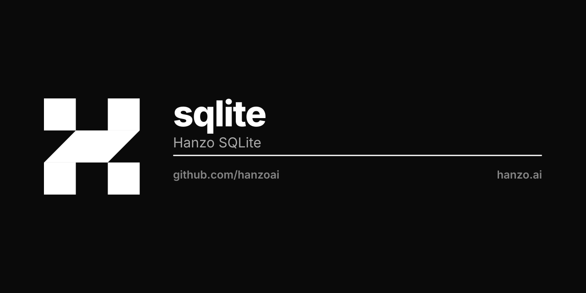

<p align="center"></p>

# Hanzo SQLite

Dual-backend SQLite driver for the Hanzo ecosystem. Registers the
`database/sql` driver name **`sqlite`** under both build configurations and
exposes the same API either way:

| Build | Backend | Keyed-store encryption | Use |
|-------|---------|-----------------------|-----|
| `CGO_ENABLED=1` | hanzoai/csqlite | Live SQLCipher if linked; codec envelope otherwise | **production** |
| `CGO_ENABLED=1` + `-tags sqlite_purego` | modernc.org/sqlite (pure Go) | SQLCipher-compatible codec envelope | CI / lint / local dev |
| `CGO_ENABLED=0` | modernc.org/sqlite (pure Go) | SQLCipher-compatible codec envelope | CI / lint / local dev |

One import, one driver name, two backends:

```go
package main

import (
	"database/sql"
	_ "github.com/hanzoai/sqlite"
)

func main() {
	db, err := sql.Open("sqlite", "file:app.db")
	if err != nil {
		panic(err)
	}
	defer db.Close()
}
```

Encryption applies when you open a store with a key. The pure-Go backend uses the
SQLCipher-compatible codec envelope, and the cgo backend uses live libsqlcipher
when its runtime probe confirms that the codec is linked. If it does not, cgo
also falls back to the pure-Go codec envelope. A keyed store is therefore
encrypted on both backends; opening without a key is unencrypted.

## Using the optional live SQLCipher backend (cgo)

The `hanzoai/csqlite` driver has **no `sqlcipher` build tag** and no `sqlite3_key()` binding.
The live SQLCipher codec works only when you:

1. link the **system** sqlite (the `libsqlite3` tag) against **libsqlcipher**, and
2. enable the codec + URI keying via CGO flags, and
3. supply the key as SQLCipher's **native URI `key` parameter** so it is applied
   inside `sqlite3_open_v2` — *before* csqlite's pragma battery runs.

```sh
CGO_ENABLED=1 \
CGO_CFLAGS="-DSQLITE_HAS_CODEC -DSQLITE_USE_URI=1 -I<sqlcipher>/include/sqlcipher" \
CGO_LDFLAGS="-L<sqlcipher>/lib -lsqlcipher" \
go build -tags "libsqlite3 sqlite_fts5" ./...
```

Alpine: `apk add gcc musl-dev sqlcipher-dev pkgconfig`.

### Why not `-tags sqlcipher` + `PRAGMA key` in a ConnectHook?

Both are traps that ship **plaintext**:

- `-tags sqlcipher` is inert in csqlite (no such tag) → links plain
  sqlite → `PRAGMA key` is a silent no-op.
- csqlite runs `PRAGMA busy_timeout/journal_mode/foreign_keys/...` via
  `sqlite3_exec` **before** the ConnectHook fires. On an existing encrypted file
  that touches the header before the key is set → `file is not a database` on
  reopen. So a ConnectHook can *create* but never *reopen* a SQLCipher DB.

The URI `key` parameter sidesteps both: SQLCipher's VFS keys the connection at
open time. `TestEncryptionProof` asserts real ciphertext on disk and a working
keyed reopen, so a mis-linked build **fails CI** instead of shipping plaintext.

> On the live cgo path, the key rides the DSN (`file:PATH?...&key=x'HEX'`).
> **Never log the DSN.**
> IAM keeps `showSql=false` and does not log it.

## Encryption

- Algorithm: AES-256 (SQLCipher 4 defaults: 4096-byte pages, PBKDF2-HMAC-SHA512,
  256000 iters, per-page HMAC-SHA512).
- Key: supply a raw 256-bit key with `WithRawKey` or `OpenDB`. `WithKey` hashes a
  passphrase once with SHA-256 and is suitable only for a high-entropy secret; it
  is not a password-hardening KDF. For human-memorable passwords, derive a key
  out of band with a salted KDF such as Argon2id or PBKDF2, then pass it with
  `WithRawKey`.

```go
package main

import (
	"encoding/hex"
	"log"
	"os"

	sqlite "github.com/hanzoai/sqlite"
)

func main() {
	// Load a stable 32-byte key from your secret manager; never log it.
	key, err := hex.DecodeString(os.Getenv("SQLITE_KEY_HEX"))
	if err != nil {
		log.Fatal(err)
	}

	db, err := sqlite.Open("data.db", sqlite.WithRawKey(key))
	if err != nil {
		log.Fatal(err)
	}
	defer db.Close()
}
```

## Threshold write attestation

`ThresholdManager` coordinates t-of-n Ed25519 attestations for writes (MPC shard
storage, multi-sig). Pure Go; available under both backends.

## License

MIT OR Apache-2.0, at your option — per [HIP-0137](https://github.com/hanzoai/hips/blob/main/HIPs/hip-0137-one-license.md).
